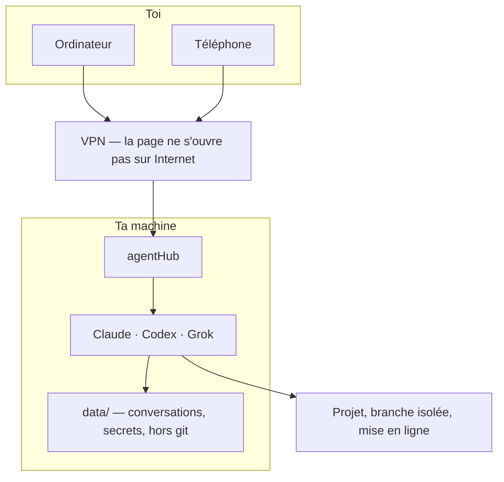

# agentHub

Un cockpit web pour [Claude Code](https://docs.anthropic.com/en/docs/claude-code), [Codex](https://github.com/openai/codex) et [Grok Build](https://x.ai). Tu ouvres la même page depuis l'ordinateur ou le téléphone, tu lances un agent, et le travail continue là où tu l'as laissé.

Chaque conversation est une **vraie session CLI**. Le premier message la crée, les suivants la reprennent. Pas de terminal collé dans le navigateur, pas de `/resume` à taper : le serveur traduit le flux des CLIs en fil (texte, réflexion, outils, erreurs).

Trois dépendances (`express`, `ws`, `nodemailer`). HTML, CSS et JS vanilla. Aucune étape de build.



## Ce qui le distingue

Un chat qui appelle une API ne reprend pas une session, ne voit pas tes fichiers, et ne sait pas ce que le CLI a déjà fait. Ici l'agent est le CLI, avec tes skills, tes dépôts et les droits du compte. agentHub s'occupe du reste : reprendre le fil, isoler le travail, garder une trace, et te laisser trancher quand un choix serait coûteux à défaire.

Le bind par défaut est `127.0.0.1`. **Ne publie pas ce port.** Un agent exécute du code avec tes droits. Pour y accéder depuis le téléphone, place la page derrière un VPN (Tailscale, WireGuard).

## Conversations

- **Trois agents, une sidebar.** Claude, Codex, Grok. Chaque fil a un état : en cours, terminé, erreur, interrompu.
- **Reprise réelle.** Le serveur garde l'identifiant de session du CLI. Rouvrir la conversation envoie la suite dans la même session.
- **Connexion sans terminal.** Claude, Codex et Grok s'authentifient depuis la page (code appareil ou code à coller). Aucun shell distant : en ouvrir un doublerait la surface, pour rien.
- **Un compte mort n'est pas « connecté ».** L'état vient d'une interrogation du CLI, pas de la présence d'un fichier. Les jetons ne sont jamais lus.
- **Pièces jointes.** Images, Markdown, JSON. Le fichier est posé sur le disque et donné au CLI par chemin, pas recollé en base64 dans le prompt.
- **Recherche.** Plein texte dans les fils, pas seulement le titre. L'index vit en mémoire et ne relit un journal que s'il a changé.
- **Mode objectif.** Tu donnes un but. L'agent travaille, puis un second tour — dans la même conversation, en sortie structurée — dit si c'est atteint. Le juge n'est pas le tour qui vient de conclure.
- **Prompts enregistrés.** Les consignes que tu retapes, avec des trous `{{nom}}`. Ce n'est pas une skill : le texte arrive dans le compositeur, tu le relis avant d'envoyer.
- **Envoi différé.** « Envoie ça à 18 h dans cette conversation », avec le contexte déjà construit. Pour Claude, une copie gelée de la session peut partir plus tard sans figer le fil d'origine.

Le contexte utile est celui du CLI, pas le journal de l'interface. **Compacter** demande au CLI de résumer. **Reprendre léger** ouvre une conversation neuve avec une note de passation, sans recopier un contexte saturé.

## Relais

Deux fournisseurs ne partagent pas de format de session, et leurs fenêtres de contexte ne font pas la même taille. Passer la main, c'est écrire une note, pas copier un fichier.

La note reste dans les données d'agentHub. Elle ne va pas dans le dépôt du projet : un artefact d'outillage n'a rien à faire dans un commit.

Une **équipe** enchaîne trois conversations visibles, que tu peux lire, couper ou reprendre :

1. planifier, sur le dépôt ;
2. coder, dans un worktree à lui ;
3. relire, depuis un **autre** fournisseur, sur la branche — pas depuis le worktree du codeur.

Le relecteur ne valide pas le travail du modèle qui vient de l'écrire. Supprimer la conversation du codeur n'emporte pas le sol sous le relecteur.

## Déclencheurs

Le planificateur vit dans le processus. Les échéances sont enregistrées : un redémarrage ne les oublie pas. L'heure est murale (`Europe/Paris` par défaut, `AGENTHUB_TZ` sinon). « Chaque jour à 7 h » part à 7 h, y compris au changement d'heure.

| Fréquence | Rôle |
|---|---|
| Une fois | Un rendez-vous. Ne se réarme pas. |
| Toutes les heures, toutes les 6 h | Cadence courte, calée sur la création. |
| Jours choisis | Une heure de la journée. |
| Webhook | Un événement (push, alerte, formulaire). Pas d'échéance. |

Un webhook n'a pas le garde-fou d'une cadence. Deux protections : **une exécution à la fois** (l'événement suivant est refusé, pas mis en file), et **une minute minimum** entre deux lancements. Le jeton est le secret de l'URL. Le bind local fait le reste.

À la fin, un second tour rédige le rapport dans la même conversation — sujet, statut, corps — puis un mail ou une notification peut partir. Le rapport n'est pas écrit dans la consigne de départ : à ce moment-là, le travail n'est pas fini.

Les notifications (ntfy ou webhook) partent même téléphone éteint. Si la conversation est déjà ouverte devant toi, le téléphone ne sonne pas.

## Git, sans se marcher dessus

Deux conversations sur le même dossier écrivent les mêmes fichiers. Pire : l'instantané de l'une enregistre le travail de l'autre, et une restauration défait ce que personne ne lui a demandé.

Un **worktree** par conversation : même dépôt, deux répertoires, deux branches `agenthub/…`. Rien n'est fusionné tout seul. Une branche qui porte du travail n'est pas supprimée.

Avant chaque tour, un **instantané** des fichiers. Le rewind du CLI n'existe pas en mode non interactif, et réécrire sa session serait parier sur un format privé. Le filet est un dépôt git fantôme, rangé dans `data/`, dont le work-tree pointe vers le projet. Aucun `.git` n'est ajouté au projet. Ça marche sur un dépôt comme sur un dossier ordinaire.

Le panneau de la conversation dessine le graphe du **vrai** dépôt : commits, parents, colonnes. Le placement est calculé dans l'app. Pas de bibliothèque de graphe.

## Le projet, pas la conversation

Notes, règles et mémoire sont rangées **par dépôt**. Une idée notée dans un fil se retrouve dans le suivant, quel que soit l'agent. Pour un worktree, la clé est le dépôt principal : chaque branche n'a pas sa liste.

- **Notes.** Tickets `à faire` / `en cours` / `fait`, avec texte et images. La liste ouverte est donnée dans le prompt. Le détail s'obtient à la demande.
- **Idées.** Une ligne `[idée] Titre — description` devient une carte. Un clic l'ajoute aux notes. Le marqueur est explicite : une liste de fichiers n'est pas une proposition.
- **Plans et schémas.** Ce sont les fichiers du projet (`docs/plans/`, cadrages, mermaid), suivis par git. agentHub les découvre, les range (section, statut, date) et les édite. Il n'en garde pas de copie : une copie dériverait au premier edit de l'agent. Rien ne se supprime par cette voie.
- **Règles.** « Ne pas pousser sur `main` », « prévenir après un déploiement ». Le prompt porte le nom et le moment. Le corps est lu quand le geste arrive. Une règle marquée « toujours » est recopiée en entier : elle ne doit pas dépendre du fait que l'agent ait pensé à la chercher.
- **Mémoire.** Une leçon n'entre dans les tours suivants qu'une fois gardée. Elle n'est proposée qu'après un tour qui s'est cogné puis a fini. Le prompt est borné en nombre et en longueur.
- **Questions.** L'agent appelle l'outil MCP `ask_user` et **attend**. Le tour n'est pas coupé. À utiliser quand un mauvais choix serait coûteux à défaire. Une préférence réversible, il la tranche.
- **Skills.** Le catalogue vient du CLI (`/` dans le compositeur). Un atelier écrit de nouvelles skills ; l'agent pose les fichiers lui-même.

## Navigateur et comptes

Playwright MCP, optionnel, donne Chromium aux agents. Headless, il ne peut pas saisir un mot de passe à ta place. Quand une page le demande, la même session s'ouvre dans l'interface : image, clic, frappe, défilement. Le mot de passe n'est pas journalisé. Une fois la fenêtre fermée, le prochain Chromium retrouve les cookies.

Si un agent est bloqué sur une connexion (Google, un hébergeur, un CLI), il dépose une demande : service, URL, raison. Tu valides dans la page. La session reste sur la machine.

OAuth Google est optionnel (identité, Drive, Gmail, Calendar). Identifiants et jetons vivent dans `data/`, chiffrés avec une clé locale en `0600`. Rien de cela n'est versionné.

## Consommation

Un journal append-only, une ligne par tour et par modèle. Les agrégats se recalculent à la lecture : provider, modèle, semaine, projet. Les tarifs de `config/pricing.json` couvrent les CLIs qui ne chiffrent pas eux-mêmes.

Les quotas d'abonnement sont lus chez le CLI, pas estimés. L'échéance de remise à zéro est une date, pas une phrase.

## Sécurité

L'app lance des agents. Le modèle de menace est celui d'un outil local, pas d'un site public.

- **Écoute sur `127.0.0.1`.** Changer `HOST` pour ouvrir le port sur Internet expose l'exécution de code. Passe par un VPN.
- **Pas de terminal web.** Les flux de connexion des trois CLIs sont parsés (URL, code). Rien d'autre n'est exposé.
- **Secrets de projet.** L'agent connaît les **noms**. Les valeurs passent par l'environnement du process, en `0600`, hors du dépôt d'agentHub et hors du dépôt du projet. Elles ne reviennent pas au navigateur. Si une commande les affiche quand même, elles sont masquées dans le fil, le journal et le websocket avant d'arriver à l'écran.
- **`data/` hors git.** Conversations, images, journal, notes, worktrees, jetons. Le détruire efface l'historique. Ce n'est pas récupérable depuis une révision.
- **SMTP hors git.** `config/mail.json` n'est pas versionné. L'exemple versionné ne contient pas de mot de passe. Sans le fichier réel, l'envoi est simplement indisponible.
- **Panneau machine en lecture seule**, si tu en branches un. Jeton GET, liste blanche de chemins. agentHub ne redémarre rien par là. Sans jeton, la vue est éteinte.
- **Fichiers statiques en `no-cache`.** Un téléphone ne garde pas une interface périmée après un déploiement.

## Téléphone et ordinateur

La même page : menu, fil, compositeur, pièces jointes. Depuis le téléphone tu ouvres une conversation, tu choisis le dossier, tu lances l'agent. La présence passe par le websocket : un téléphone en veille est compté absent au bout d'un court silence, et une question sans personne devant l'écran déclenche la notification.

La dictée au doigt tenu a besoin d'une page en HTTPS. Servie en HTTP derrière le VPN, c'est la touche micro du clavier qui écrit dans le champ.

## Mettre un projet en ligne

Les agents tournent **sur la machine**, avec les skills déjà installées. Une skill peut enchaîner l'écriture du projet, son lancement et sa publication : vhost, enregistrement DNS, URL publique à la fin du tour. Tu le fais depuis le bureau ou depuis le téléphone, dans la même conversation.

agentHub n'achète pas de domaine et n'embarque aucun compte d'hébergeur. Il pilote les outils présents sur la machine. Les jetons de cette chaîne sont des secrets de projet : noms connus de l'agent, valeurs uniquement dans l'environnement, masquées si elles fuient dans une sortie.

## Lancer

Node 18 ou plus. Les CLIs que tu comptes utiliser sont installés et authentifiés sur la machine.

```bash
npm ci
npm test
HOST=127.0.0.1 PORT=3901 npm start
```

Ouvre [http://127.0.0.1:3901](http://127.0.0.1:3901).

## Configuration

Les fichiers de `config/` sont relus à chaque usage. Pas de redémarrage.

| Fichier | Rôle |
|---|---|
| `groups.json` | Dossiers proposés à la création d'une conversation |
| `models.json` | Menu Modèle |
| `pricing.json` | Tarifs, pour les CLIs qui ne chiffrent pas |
| `notify.json` | Notifications (ntfy ou webhook). Désactivé tant que `enabled` est faux |
| `browser.json` | Serveur MCP Playwright des agents |
| `connections.json` | Navigateur humain temporaire |
| `memory.json` | Mémoire de projet |
| `mail.example.json` | À copier en `mail.json` pour l'envoi SMTP |

La page **Paramètres** écrit dans `data/settings.json`, par-dessus ces défauts. Elle n'écrit pas dans `config/` : ça salirait le dépôt.

### Variables d'environnement

| Variable | Défaut | Rôle |
|---|---|---|
| `HOST` | `127.0.0.1` | Adresse d'écoute. Laisser le défaut. |
| `PORT` | `3901` | Port |
| `AGENTHUB_TZ` | `Europe/Paris` | Heure murale des déclencheurs |
| `AGENTHUB_DATA` | `./data` | État local |
| `AGENTHUB_GROK_BIN` | `grok` | Binaire Grok |
| `AGENTHUB_CLAUDE_BIN` | `claude` | Binaire Claude |
| `AGENTHUB_CODEX_BIN` | `codex` | Binaire Codex |
| `AGENTHUB_MCP_URL` | `http://HOST:PORT/mcp` | Outil `ask_user` servi aux agents |
| `AGENTHUB_GOOGLE_REDIRECT_URI` | — | Callback OAuth Google |
| `AGENTHUB_PANEL_URL` | `http://127.0.0.1:3100` | Panneau machine, appel local. Inerte sans jeton |
| `AGENTHUB_PANEL_WEB_URL` | `http://127.0.0.1:8080` | Même panneau, URL ouvrable depuis le navigateur |
| `AGENTHUB_PANEL_TOKEN_FILE` | — | Fichier du jeton GET. Absent : la vue est éteinte |

## Tenir sous PM2

`ecosystem.config.js` pose `treekill: false`. Un `pm2 restart` ne tue pas le CLI d'un tour en cours. Le flux passe par un fichier : un pipe se fermerait avec le lecteur, et le process survivant se bloquerait.

```bash
pm2 start ecosystem.config.js
pm2 save
```

Ne pas lancer avec `pm2 start server.js` : ce réglage disparaît. `pm2 delete` puis un start direct aussi.

PM2 ne charge pas `.bashrc`. Les binaires doivent être trouvables sans ça, ou pointés par les variables ci-dessus.

## Tests

```bash
npm test
npm run check
```

`npm run check` vérifie la syntaxe de chaque fichier JS, puis la suite. Les tests n'ont pas besoin des CLIs : les flux sont rejoués depuis des fixtures.

## Licence

[MIT](LICENSE).
