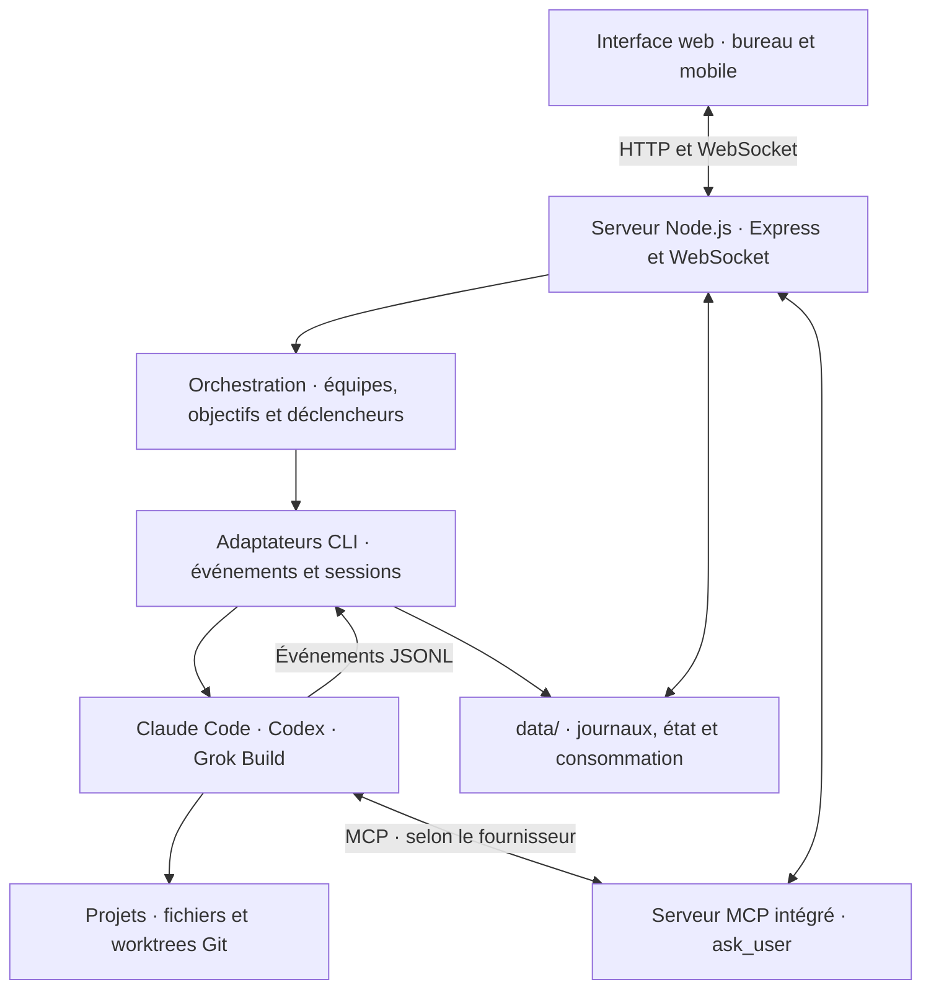

# agentHub

### Mon espace de travail pour piloter plusieurs agents de code.

**Claude Code · Codex · Grok Build**  
Sessions persistantes, orchestration entre fournisseurs et suivi des exécutions dans une interface web.

[Pourquoi agentHub](#pourquoi-agenthub) · [Du ticket à la relecture](#du-ticket-à-la-relecture) · [Ingénierie](#quelques-choix-dingénierie) · [Environnement](#environnement-et-exploitation)

## Pourquoi agentHub

J'ai créé agentHub pour mon propre usage : travailler régulièrement avec plusieurs agents de code, sur plusieurs projets, et garder la maîtrise de ce qu'ils font.

À mesure que cet usage s'est installé, les difficultés se sont déplacées. Il fallait retrouver les décisions d'une ancienne session, transmettre un travail à un autre modèle, faire avancer deux tâches sans mélanger leurs fichiers, ou redémarrer le serveur pendant qu'un agent travaillait encore.

agentHub rassemble ces besoins dans un même outil. Chaque conversation pilote une **véritable session CLI** : le premier message la crée, les suivants la reprennent. Le serveur traduit les événements des fournisseurs en un fil lisible — texte, réflexion lorsqu'elle est exposée, appels d'outils, résultats et erreurs — diffusé en temps réel par WebSocket.

**C'est le projet personnel que j'utilise le plus : ses fonctionnalités viennent des problèmes rencontrés en travaillant avec les agents au quotidien.**

**Un outil personnel, développé en conditions réelles.** agentHub évolue autour de mes usages et de mon environnement matériel et logiciel. Je partage ici son code, ses fonctionnalités et les choix techniques qui le structurent. Son utilisation dans un autre environnement peut demander des adaptations ; l'installation et les intégrations n'ont pas été validées pour une distribution généraliste.

## Du ticket à la relecture

Un exemple de parcours pris en charge par agentHub :

1. **Préparer le travail.** Un ticket porte le besoin ; les plans et schémas du dépôt donnent le contexte.
2. **Lancer une équipe.** Un premier agent propose un plan, un deuxième réalise le travail dans un worktree Git dédié, un troisième relit la branche. Le relecteur est choisi chez un autre fournisseur lorsqu'il est disponible.
3. **Suivre et intervenir.** Chaque étape reste une conversation visible, consultable, reprenable et interruptible. Un agent peut demander un arbitrage dans l'interface.
4. **Examiner le résultat.** Les différences Git, l'historique et la consommation permettent de comprendre ce qui a été produit et à quel coût estimé. La fusion du worktree se fait à la demande.

Cette chaîne **planification → réalisation → relecture** donne une structure au travail tout en laissant accès à chaque étape. Les conversations peuvent aussi être utilisées seules, ou transmises manuellement à un autre agent.

## Garder le contexte, même quand le travail change de main

### Passer d'un agent à un autre

Un relais permet de poursuivre un travail avec un autre fournisseur ou un autre modèle. agentHub prépare une note de passation pour transmettre l'objectif, les décisions et l'état du travail. Lorsque le fournisseur prend en charge le fork de session, un relais au sein de ce fournisseur peut reprendre le contexte complet.

Les sessions longues disposent également de deux actions : **compacter le contexte** via le CLI lorsque cette capacité existe, ou **reprendre léger** dans une nouvelle conversation à partir d'une note de passation. Une solution de repli peut construire cette note depuis l'historique si l'agent parent ne peut plus la rédiger.

### Conserver ce que le projet a appris

La mémoire de projet transforme certains problèmes résolus en propositions de leçons. **Seules les leçons retenues par l'utilisateur sont réinjectées** dans les échanges suivants ; leur nombre et leur longueur sont bornés pour maîtriser la place qu'elles occupent dans le contexte.

Les plans, cadrages et diagrammes Mermaid restent, eux, des fichiers du dépôt. L'interface les découvre, les classe, les affiche et permet de les modifier à leur emplacement d'origine. Ils restent versionnés avec le code et utilisables en dehors d'agentHub.

### Réutiliser ses méthodes

Un catalogue de skills rend les commandes des CLIs accessibles depuis l'interface. Un atelier conversationnel permet de créer ou modifier les fichiers `SKILL.md` et leurs ressources associées. Les consignes fréquentes peuvent aussi être enregistrées sous forme de modèles de prompts avec des variables `{{nom}}`.

## Donner de l'autonomie, avec des conditions d'arrêt

### Mode objectif

Le mode objectif alterne un tour de travail et un tour d'évaluation dédié, dont la réponse suit un schéma JSON : objectif atteint, état du travail et éléments restants. Si nécessaire, le résultat de cette évaluation devient la consigne du tour suivant.

La boucle dispose d'un **plafond de tours**, s'arrête sur une interruption ou une erreur, et rend la main si l'évaluation est inexploitable. Cette séparation structure la poursuite du travail ; l'évaluation reste produite par un modèle et demande un regard humain adapté à l'enjeu.

### Tâches planifiées et événements

Des déclencheurs lancent des agents à une date donnée, selon une récurrence ou à réception d'un webhook. Chaque exécution possède sa conversation, son état et son historique. Des rapports par e-mail et des notifications ntfy ou webhook permettent d'en suivre l'issue.

Les webhooks disposent d'un contrôle de concurrence par déclencheur et d'un délai minimal entre deux lancements. Les horaires utilisent un fuseau configurable, avec prise en compte des changements d'heure pour les récurrences calendaires.

Il est aussi possible de **programmer un message dans une conversation existante**, ou dans une copie. Lorsque le fournisseur permet de figer sa session, le contexte de cette copie est conservé dès la planification.

### Arbitrage humain pendant l'exécution

Le serveur MCP intégré expose `ask_user`. L'appel attend la réponse de l'utilisateur dans l'interface, puis la renvoie comme résultat d'outil : l'agent peut obtenir une décision sans terminer son tour. Un délai maximal borne cette attente.

## Savoir ce qui tourne, ce qui change et ce que cela consomme

Les conversations sont organisées par dossiers, filtrables par fournisseur et accessibles sur une interface adaptée au bureau comme au mobile. La recherche plein texte retrouve aussi les commandes, résultats d'outils et références à des fichiers dans les anciens échanges. Une file de messages permet de préparer les prochaines consignes pendant une exécution.

Pour travailler sur le code, agentHub associe **worktrees par conversation, consultation des différences et graphe de commits**. Des instantanés des fichiers sont pris avant les tours dans un dépôt Git séparé : on peut consulter les changements et restaurer un état sans ajouter de commits techniques dans l'historique du projet. La restauration concerne les fichiers, pas le contexte interne du modèle.

Le tableau de consommation regroupe les tokens et les coûts par fournisseur, modèle, projet, conversation et période, avec un suivi des déclencheurs. Il distingue les coûts remontés par les fournisseurs de ceux calculés à partir d'une table tarifaire. Les cumuls de tokens de Codex sont convertis en différences entre relevés pour éviter de compter plusieurs fois les mêmes tokens.

**Ces montants servent à comparer les usages : ils ne constituent pas une facture d'abonnement.**

## Étendre l'espace de travail

Des intégrations optionnelles complètent le parcours :

| Besoin | Prise en charge |
|---|---|
| Vérifier une interface | Connexion des agents à un serveur MCP Playwright externe et visualisation du navigateur dans l'interface. |
| Se connecter à un service | Navigateur d'intervention humaine partageant le profil persistant utilisé par Playwright. |
| Accéder à Google | Connexion OAuth avec groupes de permissions pour l'identité, Drive, Gmail et Calendar ; jetons chiffrés sur disque avec une clé locale. |
| Fournir des identifiants à un projet | Secrets injectés dans l'environnement des processus, valeurs non renvoyées à l'interface et masquage des valeurs reconnues dans les sorties traitées. |
| Travailler avec des visuels | Images jointes aux conversations et galerie de fichiers image produits par les agents, rangés par projet de galerie. |
| Consulter l'état du serveur | Intégration à un service d'administration externe, via un jeton de service en lecture seule. |

Le cœur de l'application fonctionne sans ces services. Le navigateur, l'envoi d'e-mails et le panneau serveur demandent leur propre configuration.

## Quelques choix d'ingénierie

Le projet couvre toute la chaîne d'un outil pour agents : intégration des CLIs, adaptation des protocoles, gestion des processus, persistance, orchestration et interface temps réel.

| Problème rencontré | Choix retenu et intérêt |
|---|---|
| Trois CLIs aux formats et capacités différents | Une table de fournisseurs centralise la construction des arguments, la traduction des événements et les capacités disponibles. L'interface s'adapte aux possibilités réelles de chacun. [Code](https://github.com/Purvanas/agenthub/blob/main/lib/runner.js) |
| Un redémarrage du serveur coupait le travail en cours | Le flux CLI passe par un fichier, avec un curseur de traitement persistant. Associé à `treekill: false` dans PM2, ce mécanisme permet de retrouver un processus survivant et reprendre la lecture de son flux après le redémarrage applicatif. [Explication](https://github.com/Purvanas/agenthub/blob/main/docs/solutions/reprendre-un-turn-apres-redemarrage.md) |
| L'historique devenait de plus en plus coûteux à enregistrer | Un cas documenté de 9,2 Mo bloquait la boucle d'événements environ 65 ms par sauvegarde. Les métadonnées sont désormais séparées d'un journal JSONL en ajout : l'écriture d'un élément dépend de sa taille plutôt que de celle du fil entier. [Explication](https://github.com/Purvanas/agenthub/blob/main/docs/solutions/le-fil-entier-etait-reecrit-a-chaque-message.md) |
| Plusieurs agents modifiaient les mêmes fichiers | Une branche et un worktree par conversation isolée, avec une fusion explicite. Les instantanés suivent le dossier de travail de cette conversation. [Code](https://github.com/Purvanas/agenthub/blob/main/lib/worktrees.js) |
| Les métriques variaient selon les fournisseurs et les fins de session | Normalisation des relevés, conversion des cumuls en deltas et conservation de la provenance des coûts. [Retour d'expérience](https://github.com/Purvanas/agenthub/blob/main/docs/solutions/la-consommation-comptait-des-cumuls-et-perdait-des-turns.md) |
| Modifier un réglage depuis l'interface salissait le dépôt déployé | Les valeurs versionnées de `config/` et les préférences de `data/settings.json` sont superposées. Les changements utilisateur restent séparés du code déployé. [Code](https://github.com/Purvanas/agenthub/blob/main/lib/settings.js) |

La stack reste volontairement compacte : **Node.js, Express, WebSocket, HTML/CSS/JavaScript vanilla**, avec trois dépendances npm directes et aucune étape de build. La persistance par fichiers correspond à l'échelle visée : un utilisateur et quelques centaines de conversations.

Les décisions de boucle, de planification ou d'admission des webhooks sont séparées de leurs effets sur les processus et les fichiers. La suite utilise le test runner natif de Node.js ; GitHub Actions l'exécute sur les pushes et les pull requests avec Node.js 22. Les incidents et leurs causes sont documentés dans [`docs/solutions`](https://github.com/Purvanas/agenthub/tree/main/docs/solutions).

### Architecture

## Environnement et exploitation

agentHub est développé pour mon environnement serveur Linux, avec des CLIs installés et authentifiés sur la machine et une exploitation via PM2. Les intégrations s'appuient sur les services disponibles dans cette architecture : serveur MCP Playwright, profil de navigateur persistant, configuration SMTP ou panneau d'administration externe.

L'application utilise Node.js et Git, sans étape de build. Sa configuration sépare les valeurs versionnées de `config/` des préférences enregistrées dans `data/settings.json`. Les conversations, journaux, secrets, images et worktrees restent dans `data/`, hors Git : ce dossier doit être sauvegardé indépendamment du dépôt.

Le redémarrage applicatif repose sur deux mécanismes complémentaires : `treekill: false` dans la configuration PM2 et la lecture du flux CLI depuis un fichier. Ils permettent de retrouver une exécution dont le processus a survécu au redémarrage d'agentHub, sans couvrir l'arrêt de la machine.

Les prérequis, commandes PM2 et paramètres sont conservés dans les [notes d'exploitation](docs/exploitation.md), comme référence technique de cet environnement.

### Cadre d'utilisation et limites

**agentHub est un outil personnel à garder sur localhost ou sur un réseau privé de confiance.** Les CLIs sont lancés avec des permissions étendues et peuvent exécuter du code avec les droits du compte serveur. Ne pas exposer directement le service sur Internet ; pour un accès distant, utiliser un réseau privé tel que Tailscale ou WireGuard et une adresse d'écoute adaptée.

- **Les capacités dépendent du CLI.** Le fork natif est pris en charge pour Claude et Grok ; Codex utilise la note de passation. Le compactage explicite est disponible pour Claude et Grok. Les évolutions de leurs protocoles peuvent demander une adaptation des intégrations.
- **L'isolation Git porte sur les fichiers et les branches.** Certains dossiers de dépendances sont partagés par liens symboliques pour éviter leur duplication. Un worktree ne constitue pas un environnement d'exécution isolé.
- **Le navigateur Playwright est partagé.** Plusieurs agents naviguant simultanément peuvent interférer ; l'intervention humaine demande aussi de libérer ce profil. Grok nécessite une inscription MCP globale effectuée hors de l'application.
- **La planification vit dans le processus serveur.** Les lancements demandent qu'agentHub fonctionne ; le mécanisme ne remplace pas un ordonnanceur distribué.
- **Le masquage des secrets réduit l'exposition accidentelle.** Les secrets de projet sont stockés hors Git avec des permissions de fichier restrictives, sans chiffrement applicatif. Le masquage ne protège pas contre un agent capable de lire et transformer une valeur.

## À propos

Je développe agentHub comme un outil personnel que j'utilise et fais évoluer au quotidien. Ce projet reflète les sujets sur lesquels j'aime travailler : rendre les agents utiles dans un vrai workflow, comprendre leurs modes d'échec et construire les outils qui permettent de les piloter. Il donne un aperçu de cette approche, du besoin jusqu'aux détails d'exécution, de persistance et d'exploitation.

## Licence

[MIT](https://github.com/Purvanas/agenthub/blob/main/LICENSE) — © 2026 Purvanas.
