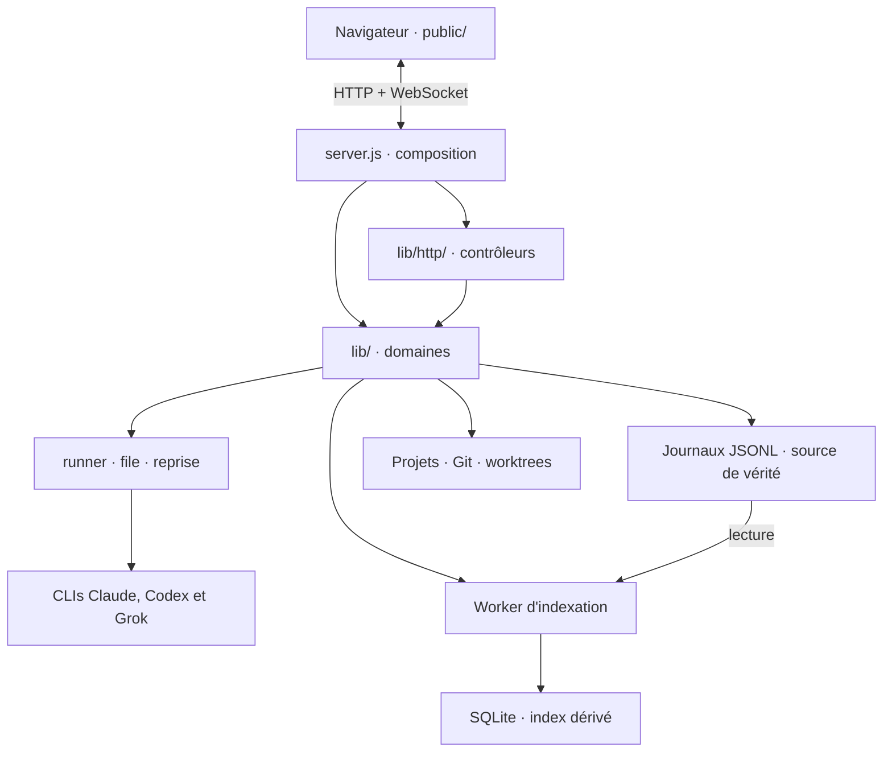
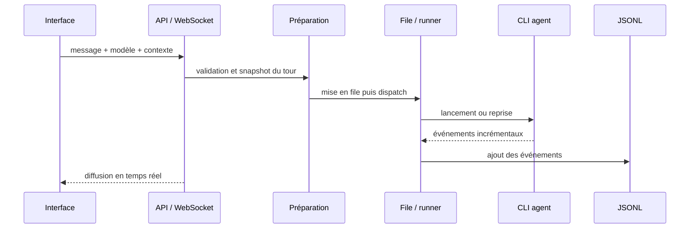

# Architecture d'agentHub

agentHub est un monolithe modulaire : un processus sert l'interface, l'API, le WebSocket et le planificateur, tandis que les domaines persistants et les intégrations restent séparés. Ce compromis garde l'exploitation simple pour un outil personnel sans faire de `server.js` l'unique propriétaire de toutes les règles.

[Présentation du projet](../README.md) · [Guide de maintenance](maintainability.md)

## Vue d'ensemble

## Frontières du code

### Composition et transport

`server.js` crée Express et le serveur WebSocket, instancie les services, injecte leurs dépendances et relie les événements persistés aux diffusions temps réel. Il conserve l'orchestration transverse ; une règle appartenant à un domaine ne doit pas y être réimplémentée.

Les modules de `lib/http/` traduisent un contrat HTTP : lecture et validation des paramètres, choix du statut, sérialisation et broadcast. Les accès aux fichiers, processus et services externes passent par les dépendances du contrôleur.

### Domaines et effets externes

`lib/` est organisé par capacité : conversations et recherche, sélection du modèle, préparation et exécution d'un tour, file et reprise, objectifs et planification, contexte projet, Git/worktrees, comptes et intégrations. Les effets externes sont encapsulés afin que les règles puissent être exercées avec des dépendances contrôlées.

La configuration utile à un tour est figée avant son lancement. Le modèle affiché pour le prochain message peut donc évoluer sans réécrire celui d'une exécution en cours ou son dernier relevé.

### Interface sans framework

`public/app.js` coordonne la navigation, le WebSocket et les états partagés. Les vues autonomes exposent une fabrique `create(deps)` et gardent leur état dans leur propre fermeture. Une réponse asynchrone devenue obsolète est ignorée si la vue, le projet ou la conversation a changé.

Le rendu des messages appartient à `public/message-renderer.js`. Il reçoit explicitement le contexte de la conversation au lieu de dépendre silencieusement de la conversation actuellement ouverte.

## Parcours d'un tour

Les processus écrivent leur flux dans un fichier suivi par un curseur persistant. Avec la configuration PM2 prévue, agentHub peut reprendre la lecture d'un tour qui a continué pendant un redémarrage applicatif.

## Lecture des longues conversations

Les journaux JSONL restent la source de vérité. Un worker maintient à côté un index SQLite dérivé contenant positions, extraits recherchables et offsets dans les journaux. Il sert trois parcours sans charger tout le fil dans le thread HTTP :

- la dernière page et les pages plus anciennes, ancrées par identifiant ;
- les résultats de recherche et l'ouverture autour d'un résultat ;
- le chargement explicite d'une sortie d'outil dont seul un aperçu a traversé le réseau.

Une base dérivée absente ou corrompue peut être reconstruite. Cette reconstruction lit les JSONL et ne les modifie pas.

## Persistance et frontières de confiance

| Emplacement | Rôle | Invariant |
|---|---|---|
| `data/conv/` | Métadonnées et événements des conversations | Évolution compatible, journaux préservés. |
| `data/indexes/` | Index de lecture et de recherche | Dérivé et recréable. |
| `data/settings.json` | Préférences de l'interface | Superposé aux défauts, jamais versionné. |
| `data/worktrees/` | Travail Git isolé par conversation | Suppression uniquement par le flux applicatif. |
| `config/` | Valeurs par défaut | Pas d'état utilisateur écrit par l'interface. |

Les CLIs s'exécutent avec les droits du compte hôte et leurs authentifications propres. Le service direct ne constitue pas une frontière d'authentification : l'adresse d'écoute locale par défaut doit rester locale, et tout accès distant relève d'un réseau privé de confiance.
