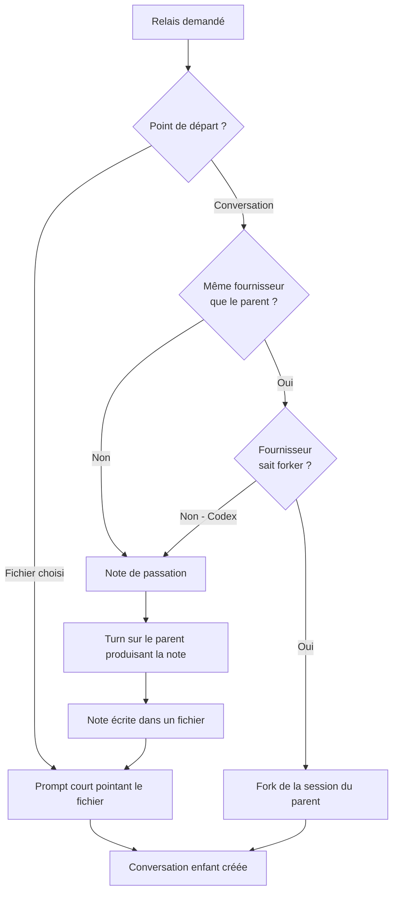
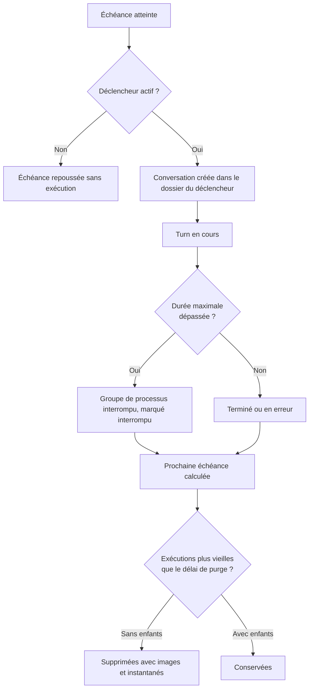

# feat: Relais entre agents et déclencheurs planifiés

**Projet cible :** `projets/agentHub`. Les chemins de ce plan sont relatifs à ce
dossier, comme ceux du README et de la copie déployée sur le serveur.

## Summary

Ajouter deux capacités à agentHub : un **relais** qui dérive une conversation vers un
autre agent ou un autre modèle dans une conversation enfant, sans consommer le parent ;
et des **déclencheurs** qui lancent un agent à heure fixe sur un dossier, chaque
exécution atterrissant dans un dossier dédié avec son coût suivi.

---

## Problem Frame

Le relais n'existe pas et l'utilisateur ne bricole plus de contournement : il renonce.
Le découpage économique évident — concevoir avec le modèle le plus capable, exécuter
avec le plus rapide — n'est donc jamais appliqué, alors que l'écart mesuré sur ce
serveur est d'un ordre de grandeur en coût.

Les déclencheurs manquent pour une raison différente : le serveur tourne en permanence
mais rien n'y lance d'agent, quand la machine porte déjà cinq tâches cron pour des
besoins voisins.

Les deux fonctionnalités partagent une contrainte structurante : agentHub est
multi-fournisseurs, et les trois CLIs ne se ressemblent pas sur les points qui comptent
ici — taille de fenêtre de contexte, capacité à forker une session, format de prompt.
Le plan ne peut donc pas traiter les trois de la même façon (voir `origin`).

---

## Requirements

**Filiation et affichage**

- R1. Une conversation peut désigner une conversation parente. Aucun comportement serveur ne distingue une conversation enfant d'une autre (origine R10).
- R2. La sidebar imbrique les enfants sous leur parent, repliables ; un enfant dont le parent est masqué par le filtre ou supprimé s'affiche à la racine avec sa provenance (origine R11, R12, R13).
- R3. Une conversation qui a des enfants n'est jamais supprimée par la purge automatique (origine R13).

**Relais**

- R4. Le relais produit une conversation enfant et laisse le parent inchangé, dérivable autant de fois que voulu. La fenêtre de relais porte les deux points de départ, les deux listes déroulantes et la consigne pré-remplie (origine R1, R2, R4, R5, R8).
- R5. Vers le même fournisseur *et* si celui-ci sait forker, l'enfant démarre par un fork de la session du parent : contexte complet, aucune note produite (origine R6).
- R6. Sinon — fournisseur différent, ou fournisseur sans fork — l'agent du parent produit une note de passation écrite dans un fichier, et l'enfant démarre en pointant vers ce fichier (origine R7, R9).
- R7. Le point de départ « fichier » propose les fichiers markdown créés ou modifiés pendant la conversation, dérivés des instantanés existants, plus une saisie libre de chemin (origine R3).

**Déclencheurs**

- R8. Un déclencheur porte fournisseur, modèle, dossier de travail, prompt, fréquence, heure le cas échéant, et peut être désactivé sans être supprimé (origine R15, R16).
- R9. Les fréquences proposées sont : toutes les heures, toutes les 6 h, chaque jour, tous les 2 jours, chaque semaine. Le choix de l'heure n'est proposé qu'à partir d'une fréquence d'un jour ou plus.
- R10. Chaque exécution crée une conversation ordinaire, rangée dans un dossier portant le nom du déclencheur, relisible et relayable (origine R19, R20).
- R11. Une exécution qui dépasse la durée configurée est interrompue et marquée comme telle ; les exécutions plus anciennes que le délai de purge sont supprimées, sous réserve de R3 (origine R17, R18).
- R12. La liste des déclencheurs affiche par déclencheur le coût total, le coût moyen par exécution, l'état de la dernière exécution et l'heure de la prochaine, dans une section dédiée (origine R14, R21, R22).

---

## Key Technical Decisions

**Planificateur interne au processus, avec rattrapage borné au démarrage.** Une ligne
de crontab appelant un endpoint n'apporterait aucune robustesse : si le processus est
arrêté, l'endpoint l'est aussi. Le crontab ajouterait en revanche une pièce à maintenir
hors de l'application. Le planificateur vit donc dans le processus, persiste la
prochaine échéance de chaque déclencheur, et au démarrage ne rattrape **qu'une seule**
exécution manquée par déclencheur — un redémarrage après trois jours d'arrêt ne doit pas
déclencher soixante-douze exécutions.

**La note de passation est un turn visible du parent.** L'alternative — forker la
session du parent dans une session éphémère pour lui demander la note sans polluer son
fil — est plus propre mais asymétrique : Codex ne sait pas forker, le cas se
dégraderait donc chez lui seul. Le turn visible traite les trois fournisseurs
identiquement, et la note dans le fil est une trace utile de ce qui a été transmis. Prix
payé : un turn de plus dans la conversation parente.

**Le fork n'impose pas l'identifiant de session de l'enfant.** Grok documente la
combinaison de `--fork-session` avec `--session-id` ; Claude ne la documente pas.
Plutôt que de parier, la conversation enfant laisse le CLI nommer la session forkée et
récupère l'identifiant depuis l'événement `init` — ce que `lib/runner.js` fait déjà via
`onSession`. La question devient sans objet.

**Les notes de passation vivent dans les données de l'application.** Les écrire dans le
dossier de travail les rendrait visibles et versionnables, au prix de polluer des dépôts
pro avec des artefacts d'outillage. Elles sont donc rangées avec les données d'agentHub
et transmises à l'agent entrant par chemin absolu, que les trois CLIs lisent sans
difficulté.

**Le déclencheur est identifié sur la conversation, et recopié dans le journal de
consommation.** `lib/usage.js` écrit aujourd'hui des lignes portant l'identifiant de
conversation. Agréger par déclencheur en remontant les conversations à chaque lecture
serait fragile et coûteux ; l'identifiant du déclencheur est donc recopié sur la ligne
au moment de l'écriture, comme l'est déjà le fournisseur.

**Vérification sans runner de tests.** Le projet n'en a aucun. Introduire une suite
maintenant élargirait le chantier sans que l'utilisateur l'ait demandé ; les unités
portent donc des scénarios exprimés en contrôles exécutables — appels d'API avec
attente précise, vérifications statiques de références — cohérents avec ce que le projet
pratique. Les deux endroits où une suite apporterait le plus sont notés en périmètre
différé.

---

## High-Level Technical Design

### Choix du mode de passation

Le relais n'a pas un chemin mais deux, et la bascule dépend de deux propriétés du
fournisseur, pas d'une.

### Cycle de vie d'une exécution planifiée

---

## Implementation Units

### U1. Filiation des conversations

- **Goal :** une conversation peut désigner un parent, et la sidebar rend cette relation.
- **Requirements :** R1, R2, R3
- **Dependencies :** aucune
- **Files :** `lib/store.js`, `server.js`, `public/app.js`, `public/style.css`
- **Approach :** ajouter `parentId` à la création et à l'entrée d'index, en le normalisant à la lecture comme l'ont été `pinned` et `folder`. Le rendu de la sidebar groupe les enfants sous leur parent dans la section où le parent se trouve déjà ; un enfant orphelin — parent masqué par le filtre, ou supprimé — est rendu à la racine avec sa provenance. La suppression manuelle d'un parent détache ses enfants au lieu de les supprimer.
- **Patterns to follow :** la normalisation à la lecture dans `store.list()`, et le rendu par sections déjà en place pour les favoris et les dossiers dans `renderList()`.
- **Test scenarios :**
  - Créer deux conversations, désigner la seconde enfant de la première : la liste renvoie bien `parentId` sur l'enfant et rien sur le parent.
  - Une entrée d'index écrite avant ce changement, donc sans le champ, est lue avec `parentId` à null et non undefined.
  - Couvre origine AE4. Parent Claude et enfant Grok, filtre masquant Claude : l'enfant apparaît à la racine, le parent est absent.
  - Supprimer un parent ayant un enfant : l'enfant existe toujours et son `parentId` est vidé.
  - Un parent avec enfants soumis à une demande de purge n'est pas supprimé.
- **Verification :** la sidebar imbrique et déplie, aucun enfant ne disparaît lors d'un filtrage ou d'une suppression de parent.

### U2. Démarrage par fork dans le runner

- **Goal :** un turn peut démarrer en forkant la session d'une autre conversation.
- **Requirements :** R5 — couvre origine F2
- **Dependencies :** U1
- **Files :** `lib/runner.js`, `lib/store.js`
- **Approach :** la table `PROVIDERS` gagne une capacité déclarée de fork. Une conversation peut porter la session à forker au premier turn ; les constructeurs d'arguments ajoutent alors `--resume <session du parent> --fork-session` au lieu de `--session-id`, sans tenter d'imposer l'identifiant de l'enfant. Le champ est consommé au premier turn puis effacé, les turns suivants reprenant la session de l'enfant comme aujourd'hui.
- **Patterns to follow :** la table `PROVIDERS` où chaque fournisseur est une entrée de données, et la capture de l'identifiant de session par `onSession` dans `runTurn`.
- **Test scenarios :**
  - Couvre origine AE1. Conversation Claude parente, enfant marqué à forker : les arguments du premier turn contiennent `--resume` et `--fork-session`, pas `--session-id`.
  - L'enfant récupère un identifiant de session distinct de celui du parent, et le parent reste réutilisable pour un second fork.
  - Deuxième turn de l'enfant : les arguments reprennent la session de l'enfant, plus aucune mention de fork.
  - Couvre origine AE3. Fournisseur déclaré sans capacité de fork : la construction d'arguments ne produit jamais `--fork-session`.
- **Verification :** deux enfants dérivés du même parent Claude répondent en connaissant le contexte du parent, et le parent conserve son historique intact.

### U3. Fenêtre de relais et endpoint

- **Goal :** déclencher un relais depuis une conversation, en deux clics.
- **Requirements :** R4, R5, R7 — couvre origine F1
- **Dependencies :** U1, U2
- **Files :** `server.js`, `lib/checkpoints.js`, `public/index.html`, `public/app.js`, `public/style.css`
- **Approach :** un endpoint de relais reçoit le point de départ, le fournisseur, le modèle et la consigne, crée la conversation enfant et lance son premier turn. Côté client, une fenêtre modale réutilise le composant déjà en place pour la restauration de fichiers : choix du point de départ, liste déroulante de fournisseurs, liste de modèles dépendante du fournisseur — les deux alimentées par la configuration existante — et consigne pré-remplie modifiable. La liste de fichiers vient d'un diff entre le premier instantané de la conversation et l'état courant, filtré sur l'extension markdown.
- **Patterns to follow :** la fenêtre modale et son placement, le remplissage dépendant des listes de modèles par fournisseur, et `lib/checkpoints.js` qui sait déjà produire un diff nommé.
- **Test scenarios :**
  - Couvre origine AE7. Conversation ayant modifié deux fichiers markdown : la liste proposée contient exactement ces deux fichiers, et aucun autre emplacement n'est parcouru.
  - Conversation n'ayant modifié aucun markdown : la liste est vide et la saisie libre reste utilisable.
  - Relais vers le même fournisseur avec un modèle différent : l'enfant est créé, le parent n'a aucun turn supplémentaire.
  - Fournisseur ou modèle absent de la requête : refus explicite, aucune conversation créée.
  - Chemin de fichier hors du dossier de travail : refusé, comme l'est déjà la résolution d'images.
- **Verification :** depuis une conversation Opus, deux clics suffisent à lancer un enfant Grok qui travaille.

### U4. Note de passation

- **Goal :** un relais croisé transmet le travail sans transmettre le fil.
- **Requirements :** R6 — couvre origine F3
- **Dependencies :** U3
- **Files :** `server.js`, `lib/handoff.js` (nouveau), `public/app.js`
- **Approach :** avant de créer l'enfant, un turn est lancé sur la conversation parente avec une consigne fixe demandant une note structurée — objectif, décisions prises, ce qui reste, pièges, fichiers touchés. Le dernier bloc de texte du turn est écrit dans un fichier rangé avec les données de l'application, et l'enfant démarre avec une consigne courte pointant ce chemin absolu. L'élément de fil correspondant est marqué comme note de passation pour être lisible comme tel.
- **Patterns to follow :** l'orchestration d'un turn et la capture de ses items dans `server.js`, et l'écriture de fichiers avec vérification de racine dans `lib/uploads.js`.
- **Test scenarios :**
  - Couvre origine AE2. Conversation Opus sans fichier de plan, relais vers Grok : un fichier de note existe, la consigne de l'enfant y renvoie et ne contient pas le fil.
  - La note est produite avant la création de l'enfant ; si le turn de note échoue, aucun enfant n'est créé et l'erreur est remontée.
  - Le parent porte un turn supplémentaire identifiable comme note de passation.
  - Relais croisé alors que le parent est déjà occupé : refusé avec un message explicite plutôt que mis en file.
- **Verification :** un agent Grok reprend le travail d'une conversation Opus longue sans que le fil ait été transmis, et la note reste lisible plus tard.

### U5. Modèle de données des déclencheurs

- **Goal :** créer, modifier, activer et supprimer des déclencheurs.
- **Requirements :** R8, R9
- **Dependencies :** aucune
- **Files :** `lib/store.js`, `server.js`
- **Approach :** les déclencheurs vivent dans l'index à côté des dossiers, pour exister sans exécution. Chacun porte son fournisseur, son modèle, son dossier de travail, son prompt, sa fréquence, son heure éventuelle, son état d'activation, ses délais d'interruption et de purge, le dossier de sidebar associé et sa prochaine échéance. La création d'un déclencheur crée son dossier. La validation refuse une fréquence inconnue, et refuse une heure sur une fréquence inférieure à un jour.
- **Patterns to follow :** la gestion des dossiers dans `lib/store.js` et leurs endpoints dans `server.js`.
- **Test scenarios :**
  - Créer un déclencheur quotidien à 7 h : il est listé, son dossier existe, sa prochaine échéance est le prochain 7 h.
  - Fréquence « toutes les 6 h » avec une heure fournie : refusée.
  - Fréquence inconnue : refusée.
  - Désactiver un déclencheur : il reste listé et son échéance n'est plus honorée.
  - Supprimer un déclencheur : ses exécutions passées ne sont pas supprimées.
- **Verification :** un déclencheur créé depuis l'API survit à un redémarrage du processus avec son échéance.

### U6. Planificateur, interruption et purge

- **Goal :** les exécutions partent seules, ne débordent pas, et ne s'accumulent pas.
- **Requirements :** R10, R11, R3 — couvre origine F4
- **Dependencies :** U1, U5
- **Files :** `lib/scheduler.js` (nouveau), `server.js`
- **Approach :** une boucle de vérification périodique compare l'heure courante aux échéances persistées. Une échéance atteinte crée une conversation dans le dossier du déclencheur puis lance son turn par le chemin d'envoi existant, avec instantané et enregistrement de consommation inchangés. Au démarrage, une seule exécution manquée par déclencheur est rattrapée. Un déclencheur portant une durée maximale arme un minuteur qui réutilise le mécanisme d'interruption existant. La purge s'exécute à la même cadence et épargne toute conversation ayant des enfants.
- **Execution note :** poser d'abord une commande de déclenchement manuel de l'échéance, avant d'activer la boucle — sans quoi chaque vérification du comportement demande d'attendre une heure réelle.
- **Test scenarios :**
  - Échéance forcée dans le passé : une exécution est créée dans le bon dossier, avec le bon fournisseur, modèle et dossier de travail.
  - Déclencheur désactivé dont l'échéance est dépassée : aucune exécution, échéance repoussée.
  - Redémarrage après plusieurs échéances manquées : exactement une exécution est rattrapée, pas une par échéance.
  - Couvre origine AE6. Exécution dépassant la durée maximale : le groupe de processus est arrêté et la conversation marquée interrompue.
  - Couvre origine AE5. Exécution plus vieille que le délai de purge et pourvue d'un enfant : ni le parent ni l'enfant ne sont supprimés ; sans enfant, la conversation et son dépôt fantôme disparaissent.
  - Calcul d'échéance sur les cinq fréquences, dont le passage à l'heure d'été sur une fréquence quotidienne.
  - Déclencheur dont le dossier de travail n'existe plus : l'exécution échoue visiblement, avec une conversation portant l'erreur, plutôt que de lancer un agent dans un dossier inattendu ou d'échouer en silence.
- **Verification :** un déclencheur créé produit une exécution à l'heure dite sans intervention, et le dossier ne dépasse pas le délai de purge.

### U7. Coût par déclencheur

- **Goal :** savoir ce que coûte un déclencheur.
- **Requirements :** R12
- **Dependencies :** U5, U6
- **Files :** `lib/store.js`, `lib/usage.js`, `server.js`
- **Approach :** une conversation issue d'un déclencheur en porte l'identifiant ; l'écriture d'une ligne de consommation le recopie, comme elle recopie déjà le fournisseur. Un agrégat par déclencheur expose le total, le nombre d'exécutions et la moyenne. Les lignes écrites avant ce changement n'ont pas le champ et sont ignorées de l'agrégat plutôt que rattachées à tort.
- **Patterns to follow :** la structure d'une ligne de journal et l'agrégation par fournisseur puis par modèle dans `lib/usage.js`.
- **Test scenarios :**
  - Deux exécutions d'un même déclencheur : le total est la somme des deux coûts et la moyenne leur moitié.
  - Une conversation créée à la main dans le même dossier n'entre pas dans l'agrégat.
  - Déclencheur sans aucune exécution : total nul, moyenne nulle, sans division par zéro.
  - Lignes de journal antérieures au champ : ignorées sans erreur de lecture.
- **Verification :** la valeur affichée pour un déclencheur correspond à la somme des coûts de ses exécutions telle que la page Consommation les rapporte.

### U8. Vue Déclencheurs

- **Goal :** créer et suivre ses déclencheurs depuis l'interface.
- **Requirements :** R8, R9, R12
- **Dependencies :** U5, U6, U7
- **Files :** `public/index.html`, `public/app.js`, `public/style.css`
- **Approach :** une vue listant les déclencheurs avec leur état d'activation, l'état de la dernière exécution, la prochaine échéance, le coût total et le coût moyen. Le formulaire de création réutilise les sélecteurs existants de dossier, de fournisseur, de modèle et d'effort. Le champ d'heure n'apparaît qu'à partir d'une fréquence d'un jour ou plus. Une mention indique, pour les fréquences infra-journalières, que le déclencheur se cale sur son moment de création.
- **Patterns to follow :** la vue Consommation et ses tuiles, le sélecteur de dossier groupé, et les listes de modèles dépendant du fournisseur.
- **Test scenarios :**
  - Choisir « toutes les 6 h » : le champ d'heure disparaît ; choisir « chaque jour » : il apparaît.
  - Changer de fournisseur : la liste de modèles se recharge et la sélection précédente ne subsiste pas.
  - Déclencheur désactivé : visuellement distinct, avec sa prochaine échéance masquée.
  - Aucun déclencheur : état vide explicite, sans tableau vide.
  - Largeur mobile : la liste ne provoque pas de débordement horizontal.
- **Verification :** un déclencheur quotidien est créé de bout en bout depuis l'interface, et son coût apparaît après la première exécution.

---

## Scope Boundaries

### Reporté par le document d'origine

- Le duel A/B entre agents, faute d'arbitre satisfaisant.
- Les notifications push, à reprendre sous forme d'activation par conversation.
- Le garde-fou de quota et le plafond de coût par exécution, remplacés par l'interruption au bout d'une durée et le suivi de coût.
- Le fan-out multi-projets.

### Différé par ce plan

- Adopter un runner de tests. Les deux endroits où il apporterait le plus sont le calcul des échéances, dont les cas limites — passages d'heure, rattrapage — sont fastidieux à vérifier à la main, et la construction d'arguments par fournisseur, où une régression est silencieuse jusqu'à l'appel réel.
- Les expressions cron complètes, au profit des cinq présélections.
- Relire ou corriger la note de passation avant le lancement de l'enfant.
- Ancrer une fréquence infra-journalière sur une heure choisie.
- Le fan-out d'un plan vers plusieurs enfants, une unité par worktree. Le découpage n'a
  pas à être inféré : `ce-plan` déclare déjà les unités et leurs dépendances, donc lire le
  plan suffit et aucun passage de modèle n'est nécessaire. La difficulté est ailleurs. Le
  graphe de dépendances laisse peu d'unités réellement parallèles — ici U1 et U5 seulement
  — et les unités d'un même plan se partagent des fichiers : U1, U3, U4 et U8 touchent tous
  `public/app.js`. Le coût se déplace donc du découpage vers la réconciliation des branches.
  À reprendre quand le relais sera en service, et sachant que compound engineering n'est pas
  installé sur le serveur. À noter pour ce jour-là : Grok expose déjà `--worktree`, qui crée
  la copie isolée sans que l'application ait à la gérer.

### Hors périmètre

- Rembobiner la conversation d'un agent : le rewind natif n'est pas accessible hors interface interactive, et réécrire l'arbre de session d'un fournisseur repose sur un format privé non documenté.

---

## System-Wide Impact

Le planificateur est le premier écrivain d'arrière-plan de l'application : jusqu'ici,
toute conversation naissait d'une action humaine. Trois conséquences.

Des turns partent sans personne devant l'écran, en autonomie totale sur un dossier de
travail. La durée maximale d'exécution est le seul frein, et il est optionnel.

L'index grossit sans intervention. Un déclencheur horaire produit sept cents
conversations par mois ; la purge n'est donc pas un confort mais la condition pour que
la sidebar et le disque restent tenables.

Le processus devient porteur d'un état temporel. Un redémarrage — donc chaque
déploiement — traverse le planificateur, d'où la persistance des échéances et le
rattrapage borné plutôt qu'une minuterie en mémoire.

---

## Risks & Dependencies

- **Un agent en autonomie totale qui part sans témoin.** Les instantanés par turn
  permettent de revenir en arrière, mais rien n'empêche un déclencheur mal formulé de
  casser un dépôt pro à 3 h du matin. La recommandation d'usage — commencer par un
  dossier sans enjeu — relève de la documentation, pas du code.
- **Le compte Claude est partagé entre le PC et le serveur.** Une exécution nocturne sur
  un modèle coûteux entame le quota de la journée, et l'utilisateur a explicitement
  écarté le garde-fou correspondant : risque accepté, consigné dans `origin`.
- **Deux déclencheurs visant le même dossier peuvent se chevaucher.** La durée maximale
  borne une exécution, pas la collision entre deux déclencheurs distincts pointant le
  même dossier de travail : deux agents peuvent alors écrire les mêmes fichiers en même
  temps. Le document d'origine ne traite que le chevauchement d'un déclencheur avec
  lui-même, écarté au profit de l'interruption par durée. Rien n'est ajouté ici ; le
  risque est nommé pour que la configuration l'évite.
- **La durée maximale peut couper un travail légitime.** Une exécution longue mais saine
  sera interrompue si le délai est mal réglé. C'est le comportement demandé ; la
  conversation reste lisible et relançable à la main.
- **L'interruption n'atteint pas les commandes que Grok a détachées.** Mesuré : pendant
  qu'un turn Grok tourne, son process n'a aucun enfant direct, et le shell qu'il a lancé
  pour un outil porte sa propre session et son propre groupe, rattaché à init. Il n'existe
  donc aucun lien — parenté, session, groupe — par lequel agentHub pourrait le retrouver.
  L'interruption tue le CLI, marque la conversation et remonte la raison ; une commande
  longue lancée par l'agent, elle, continue jusqu'à son terme. Claude, à l'inverse, garde
  ses sous-process comme enfants directs et l'arbre est donc bien parcouru. Fermer le cas
  chez Grok demanderait de lancer chaque turn dans son propre cgroup, ce qui change la
  façon de lancer *tous* les turns : disproportionné ici, à rouvrir si des commandes
  orphelines s'accumulent réellement.
- **Codex ne sait pas forker.** Un relais Codex vers Codex emprunte donc le chemin de la
  note, plus coûteux d'un turn. Vérifié sur la version installée ; si une version future
  ajoute le fork, seule la capacité déclarée dans la table des fournisseurs change.
- **Le premier instantané d'un gros dépôt prend plusieurs secondes.** Une exécution
  planifiée sur un dépôt jamais suivi paiera ce coût une fois. L'opération étant
  asynchrone, elle ne bloque pas le reste de l'application.

---

## Open Questions

Les deux questions reportées à l'implémentation ont été tranchées en cours de route.

- **Heure locale, pas UTC.** La machine est en `Etc/UTC` : un déclencheur « chaque jour à
  7 h » y serait parti à 9 h. Le processus est donc aligné sur `Europe/Paris`, surchargeable
  par `AGENTHUB_TZ`, et le fuseau effectif est exposé dans `/api/health`. Les crontabs
  système restent en UTC, ce sont des scripts d'ops. Les échéances avancent par `setDate`,
  qui conserve l'heure murale à travers un changement d'heure.
- **Cadence de vérification : 30 secondes**, surchargeable par `AGENTHUB_TICK_MS`. Les
  fréquences proposées commencent à l'heure, donc une précision à la demi-minute est large,
  et le coût d'un tick est une lecture d'index en mémoire.

---

## Sources & Research

Vérifications faites sur les versions installées, qui fondent les décisions ci-dessus.

| Fait vérifié | Conséquence dans ce plan |
|---|---|
| `--fork-session` présent chez Claude et Grok, absent de `codex exec resume` | R5 et R6, capacité déclarée par fournisseur en U2 |
| Grok documente `--fork-session` avec `--session-id`, Claude ne le documente pas | L'enfant ne se voit pas imposer d'identifiant de session (U2) |
| Fenêtres de contexte : 1 M chez Opus 5, 500 K chez Grok Build | La passation voyage par fichier, jamais par le fil |
| `lib/checkpoints.js` produit déjà un diff nommé par instantané | La liste de fichiers de U3 ne coûte rien à obtenir |
| `lib/usage.js` écrit une ligne par turn et par modèle, portant l'identifiant de conversation | L'identifiant de déclencheur est recopié à l'écriture (U7) |
| Le premier instantané d'un dépôt de 277 Mo prend environ 4,7 s, les suivants 52 ms | Risque de latence borné à la première exécution d'un déclencheur |
| Aucune dépendance de test dans `package.json` | Scénarios exprimés en contrôles exécutables, runner différé |
