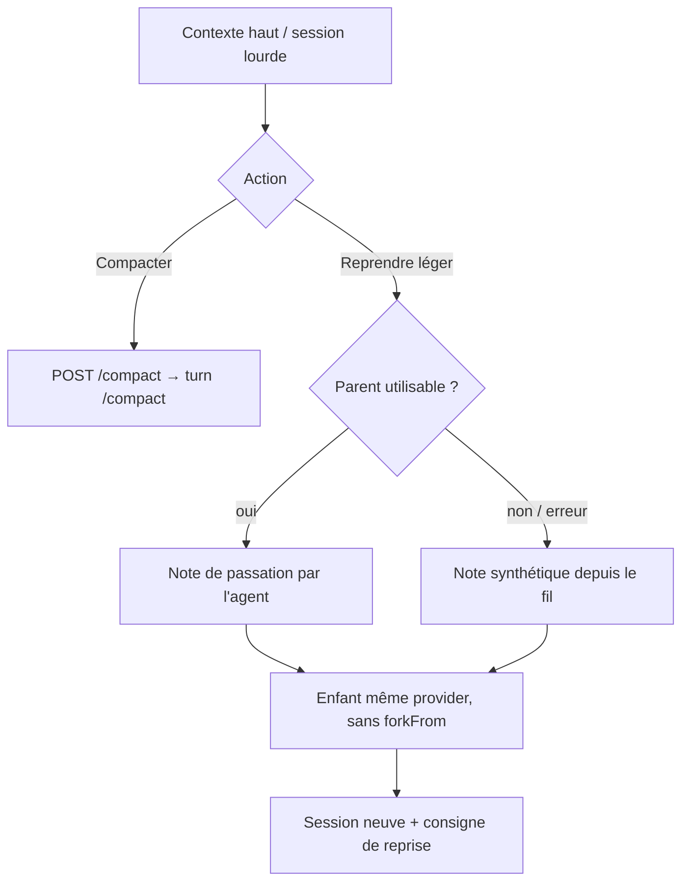

# feat: Boutons compactage et reprise légère

## Résumé

Deux actions dans l'en-tête d'une conversation : **Compacter** (envoie `/compact` au CLI) et **Reprendre léger** (nouvelle conversation via note de passation, sans fork de session). Objectif : éviter les « Échec du turn » par contexte saturé, et pouvoir repartir même quand la session est déjà morte.

## Problème

Une longue session + beaucoup de lectures d'images gonfle le contexte jusqu'à faire planter le provider (`error_during_execution`). L'UI dit déjà « Pense à `/compact` » à 65 %, mais il n'y a pas de bouton. Un fork classique recopierait tout le contexte — inutile ici.

## Conception

- **Compacter** : Claude et Grok seulement (slash `/compact` documenté). Codex : bouton caché. Endpoint dédié pour refuser clairement et marquer le message.
- **Reprendre léger** : **jamais** de `--fork-session` — on force le chemin note, même fournisseur. Si le parent tourne ou est en erreur et ne peut plus produire de turn, on écrit une note synthétique (titre, objectif, derniers messages utilisateur, extrait de réponses) pour que ça marche sur une session morte.
- UI : deux boutons près de l'anneau de contexte + entrées dans le menu mobile.

## Fichiers touchés

- `lib/context-actions.js` — helpers purs (support, prompt, note synthétique)
- `lib/handoff.js` — éventuellement rien ; on réutilise `write` / `childPrompt`
- `server.js` — `POST …/compact` et `POST …/resume-light`
- `public/index.html` / `public/app.js` / `public/style.css` — boutons + câblage
- `README.md` — section contexte
- `test/context-actions.test.js`

## Étapes

- [x] Helpers + tests
- [x] Endpoints serveur
- [x] UI desktop + mobile
- [x] Doc README
- [x] `npm run check`

## Vérification

- `npm test -- test/context-actions.test.js`
- `npm run check`
- Bouton Compacter visible sur Grok/Claude, absent sur Codex
- Reprendre léger crée un enfant `parentId` set, `forkFrom` null, avec note

## Écarté

- Fork de session pour « reprendre léger » : recopierait le contexte saturé.
- Compacter côté agentHub en réécrivant le journal affiché : le contexte utile vit dans la session CLI, pas dans le jsonl UI.
